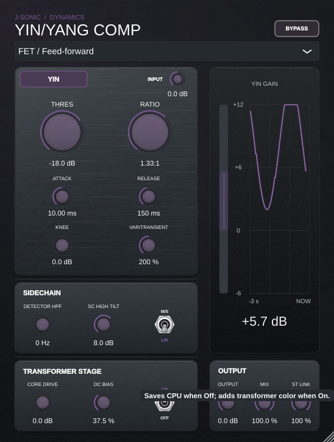

# YinYang Compressor hover hints

| Control | Hover hint |
| --- | --- |
| Compressor model | Selects the compressor model used for detection and gain reduction. |
| Output transformer | Saves CPU when Off; adds transformer color when On. |
| Bypass | Bypasses compression and coloration for a direct comparison. |
| Yin/Yang mode | Switches between Yang compression above threshold and Yin boosting below threshold. |
| Mid/Side mode | Processes stereo as mid and side before decoding it back to left and right. |
| Input | Adjusts the level entering the compressor and its detector. |
| Threshold | Sets the level above which Yang compresses and below which Yin boosts. |
| Ratio | Sets compression strength from 1:1 to 20:1 in Yang or 1:1 to 2:1 in Yin. |
| Attack | Sets attack timing in Yang and release timing in Yin. |
| Release | Sets release timing in Yang and attack timing in Yin. |
| Knee | Softens the transition around the compression threshold. |
| Output | Adjusts output gain after the wet and dry mix. |
| Mix | Blends the processed signal with the original input. |
| Detector HPF | Removes low frequencies from the detector, with 0 Hz disabling the filter. |
| Core drive | Increases saturation in the enabled output transformer. |
| Stereo link | Blends each channel's detector toward the louder channel's detector. |
| DC bias | Adds transformer asymmetry to increase even harmonics. |
| VariTransient | Slows attack and speeds release as Yang gain reduction increases. |
| SC High Tilt | Boosts high frequencies in the sidechain to increase their compression sensitivity. |
