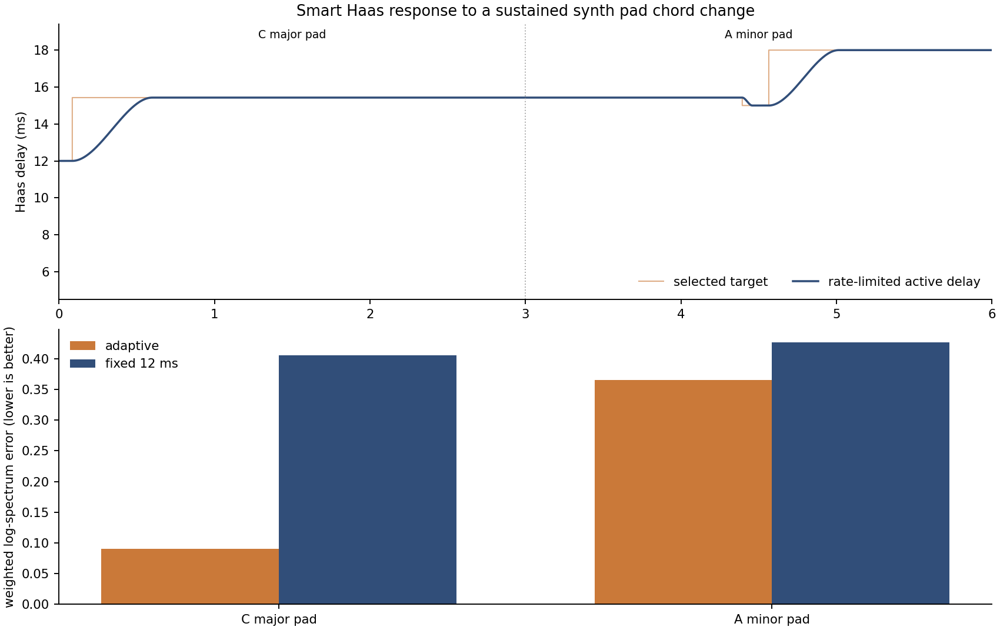
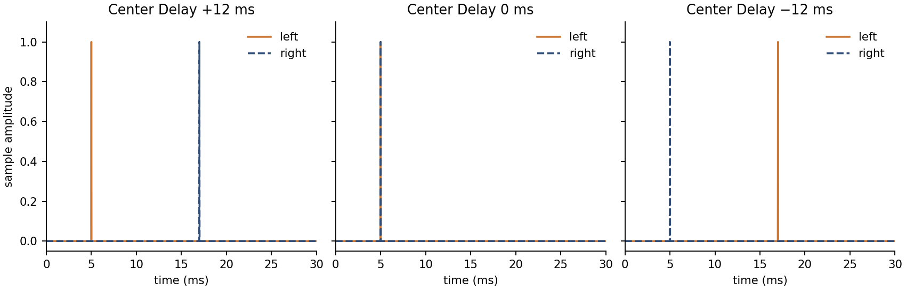
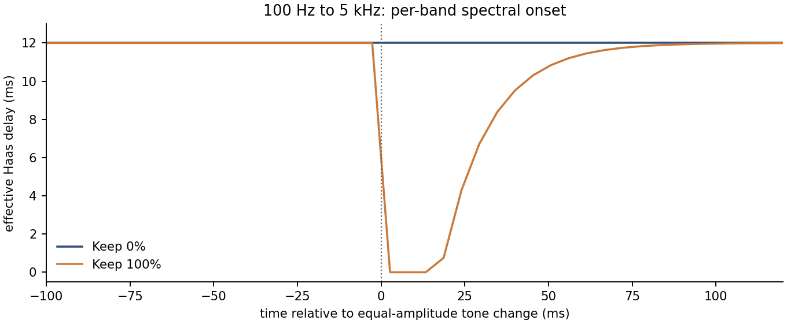
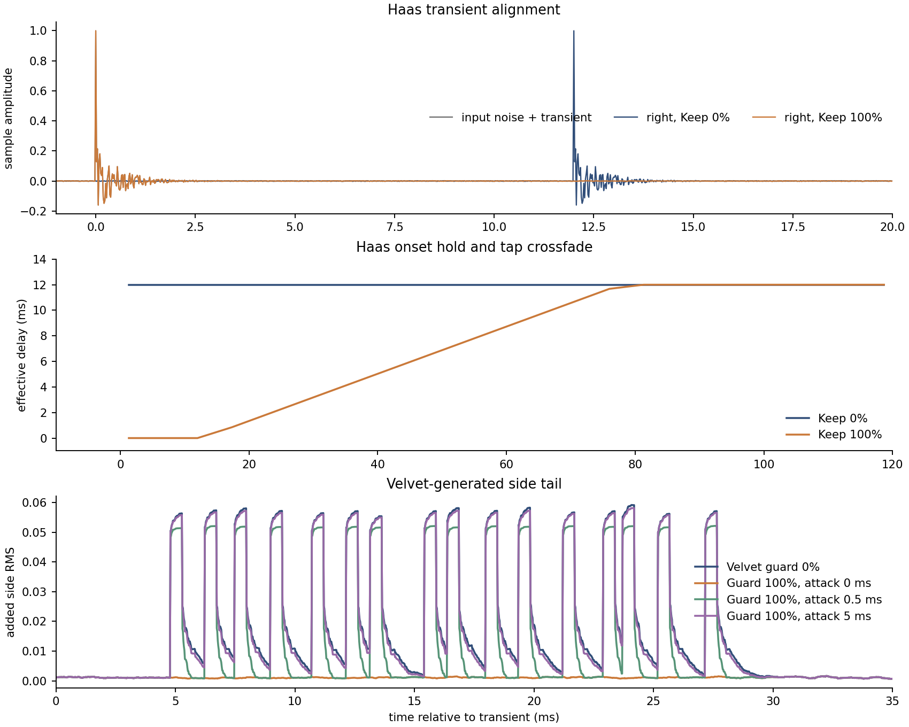
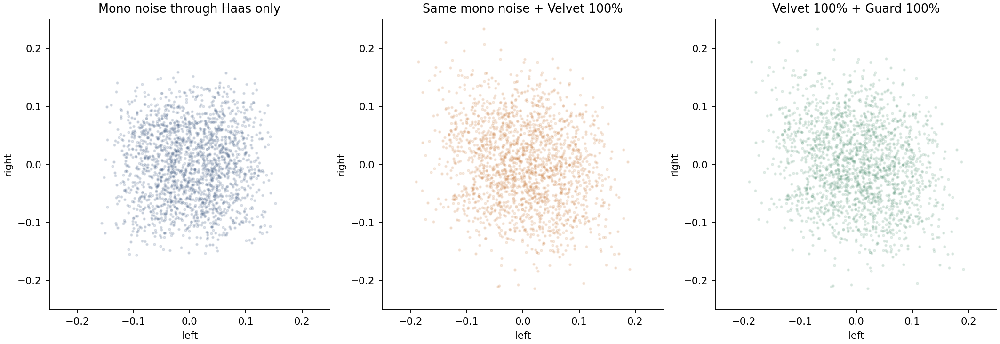
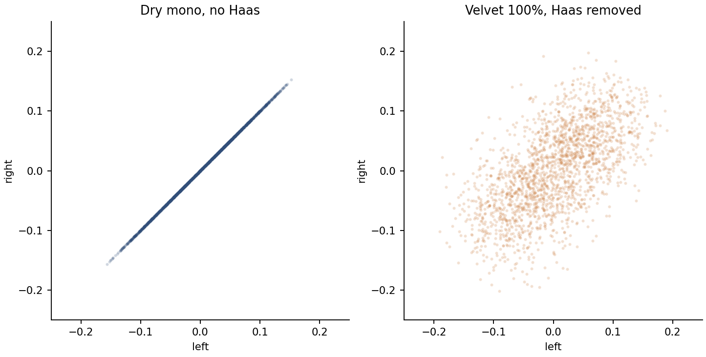
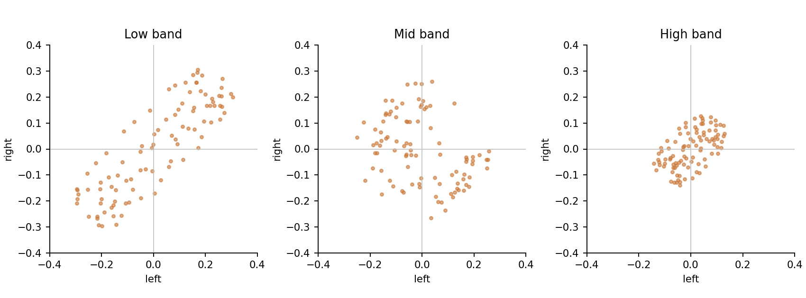

# Kuo Stereo feature measurement report

This report measures the actual `KuoStereoProcessor` at 48 kHz in 256-sample blocks.
Signals are synthetic and deterministic; no listening or host test is implied.
The measurement executable and this plotting script reproduce every figure and sample.

## Smart Haas: content adaptation and spectral preservation

A six-second mono synth pad plays C major (C4–E4–G4) for 3 s, then
A minor (A3–C4–E4) for 3 s. Detuned oscillators and harmonics give
each note a sustained pad timbre; the chord transition crossfades over
125 ms. The two chords share two notes and are close in overall level.
Center is 12 ms, Variability is ±6 ms, Max Rate is 10 ms/s,
and Velvet Width is 0%. Smart Haas scores 30 delays in 2048-sample
windows every 1024 samples, averages candidate scores over 600 ms,
and requires a 5% improvement before changing its selected delay.
The fixed comparison uses the same processor with Variability at 0 ms.
The first 0.5 s and final 0.2 s of each chord are excluded from the steady-state table.
The error is the mean of weighted absolute log FFT-magnitude ratios
between input and processed mid, over 512-sample Hann windows; lower is better.



Listen to the [pad input](smart-haas-pad-input.wav),
[adaptive mid](smart-haas-pad-adaptive.wav), and
[fixed-delay mid](smart-haas-pad-fixed.wav).

| Content | Most common target | Target changes | Median active delay | Adaptive error | Fixed 12 ms error |
| --- | ---: | ---: | ---: | ---: | ---: |
| C major pad | 15.4 ms | 0 | 15.43 ms | 0.091 | 0.405 |
| A minor pad | 18.0 ms | 2 | 15.85 ms | 0.362 | 0.427 |

The C major and A minor input levels are 0.088
and 0.086 RMS over the steady windows.
The selected target moves from 15.4 ms on C major to 18.0 ms on A minor.
C major has 0 target changes during its steady window; A minor has 2. The target stays inside 6–18 ms;
the largest active-delay step is 10.0 ms/s (10 ms/s setting).
Adaptive processing reduces the spectral error by 77.5% on C major and 15.2% on A minor against the fixed 12 ms delay in this pad test.

## Smart Haas: zero and negative delay

A mono impulse at 5 ms runs through the processor with Variability and
Velvet Width at 0%. Positive Center Delay shifts the right channel;
negative Center Delay shifts the left, so the right leads without lookahead.
At 0 ms, both channels pass through together.



The +12 ms setting peaks at 5 ms left and 17 ms right; 0 ms peaks at 5 ms on both channels; −12 ms peaks at 17 ms left and 5 ms right.

## Keep Transient and Velvet Transient Guard

The shared onset detector compares fast and slow magnitude envelopes in four
mid-channel frequency bands: below 250 Hz, 250 Hz–2.5 kHz, 2.5–8 kHz,
and above 8 kHz. It triggers on a sharp rise in any one band rather than
on the total mid-channel level. As an equal-amplitude check, a 100 Hz
tone switches to 5 kHz after 1 s; both tones are 0.18 peak amplitude.
Haas Keep holds for 10 ms after the last detected onset, then decays
exponentially to 1% protection over 65 ms. Velvet Guard attenuates
convolution input only while the detector reports an onset, with no
fixed suppression interval.
Guard Attack sets a 0–10 ms linear ramp into attenuation while the
detector remains active. At 0 ms the guard acts immediately; longer
settings let more of a brief attack into Velvet's convolution history.



Keep Transient at 100% moves from 12.00 ms before the switch
to 0.00 ms at the first measured block after it; Keep 0%
remains at 12 ms. This checks the frequency-specific trigger independently
of a broadband level increase.

A 1.0-amplitude onset with a short decaying noise burst is placed in a
0.002-amplitude white-noise bed. Haas Center is 12 ms and Variability is 0 ms.
Keep Transient is compared at 0% and 100% with Velvet Width at 0%.
Separately, Velvet Width is 100% and Transient Guard is compared at 0% and
100%; the Haas-only side signal is subtracted to isolate Velvet's added side.



- At onset, the right sample is 0.0011 with Keep 0% and 0.9995 with Keep 100% (input 0.9995).

| Guard Attack | Velvet-added side RMS, 4–28 ms | Reduction vs Guard 0% |
| --- | ---: | ---: |
| Guard 0% | 0.03363 | — |
| 0 ms | 0.00111 | 96.7% |
| 0.5 ms | 0.02992 | 11.0% |
| 5 ms | 0.03308 | 1.6% |

- The protected Haas path reaches 0 ms during the onset and returns
  exponentially after its 10 ms hold; normal Haas stays at 12 ms.
- At 76.0 ms after the transient, the active delay is 11.86 ms, leaving 1.1% protection.

## Velvet Width: widening a mono signal

A 1.5 s mono, low-pass-filtered white-noise excerpt is processed with
the same fixed 12 ms Haas delay: Velvet Width at 0%, at 100% with
Guard 0%, and at 100% with Guard 100%.
The Haas-only render is the baseline; the change between renders is Velvet.



- Side RMS rises from 0.04476 to 0.05488 (22.6% increase).
- Velvet itself adds 0.03158 side RMS while the mid difference between renders is 0.0000000 RMS.
- With Guard 100%, side RMS is 0.05486 and the Velvet-added side RMS is 0.03155; sustained width remains audible.
- Left/right correlation changes from 0.003 to -0.198.
- Listen to [mono input](mono-input.wav), [Haas only](mono-haas-only.wav),
  [Haas + Velvet 100%](mono-velvet-100.wav), and
  [Haas + Velvet 100% + Guard 100%](mono-velvet-guard-100.wav).

For the Velvet-only comparison, subtract the Width 0% render from the
Width 100% render sample by sample, then add that residual to the dry
mono input. This cancels the Haas path while retaining the processor's
actual Velvet output.



- With Haas removed, Velvet produces 0.03158 side RMS and left/right correlation 0.602; the dry input has zero side RMS.
- The Velvet-only mid differs from the dry mono input by 0.0000000 RMS.
- Listen to the [Velvet-only render](mono-velvet-only.wav).

## Frequency Field: split goniometer

An 80 Hz, 700 Hz, and 5 kHz stereo tone mix feeds the processor. The three
plots are the actual 96-point scope buffers read from the processor, using
its below-250 Hz, 250 Hz–2.5 kHz, and above-2.5 kHz splits.



| Band | Points | Left RMS | Right RMS |
| --- | ---: | ---: | ---: |
| low | 96 | 0.1766 | 0.1765 |
| mid | 96 | 0.1305 | 0.1291 |
| high | 96 | 0.0726 | 0.0709 |

All bands receive nonzero processed stereo points; this verifies the visual
data path, not calibrated filter separation.

## Reproduce

From the repository root, after configuring `projects/KuoStereo` with
`-DKUO_BUILD_TESTS=ON`:

```bash
cmake --build build-kuo-stereo --target KuoStereoFeatureMeasurements --parallel 4
./build-kuo-stereo/KuoStereoFeatureMeasurements /tmp/kuo-feature-data
python3 projects/KuoStereo/Measurements/generate_report.py /tmp/kuo-feature-data
```

The plotting step requires NumPy and Matplotlib. Output goes to
`projects/KuoStereo/Measurements/Report` unless a second path is supplied.
