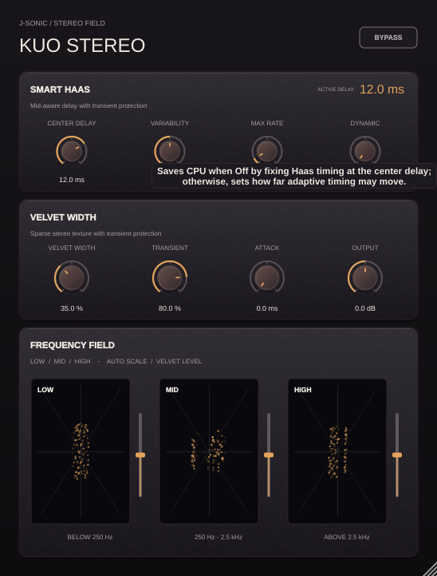

# Kuo Stereo hover hints

| Control | Hover hint |
| --- | --- |
| Plugin title | Developer: J-Sonic Team; Year: 2026; Version: 0.5.0 |
| Bypass | Bypasses the stereo widening for a direct comparison. |
| Center Delay | Sets the center Haas delay, with positive values delaying right and negative values delaying left. |
| Variability | Saves CPU when Off by fixing Haas timing at the center delay; otherwise, sets how far adaptive timing may move. |
| Max Rate | Limits how quickly the active Haas delay changes to avoid chorus-like movement. |
| Dynamic | Shortens Haas delay during detected transients to keep attacks tight. |
| Velvet Width | Sets the amount of stereo side signal added by Velvet convolution. |
| Transient | Reduces Velvet widening during detected onsets to keep transients crisp. |
| Attack | Sets how quickly Velvet transient protection engages after an onset. |
| Output | Adjusts the final output level. |
| Low Velvet | Sets the low-frequency Velvet level from 0% to 200%. |
| Mid Velvet | Sets the mid-frequency Velvet level from 0% to 200%. |
| High Velvet | Sets the high-frequency Velvet level from 0% to 200%. |
