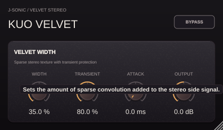

# Kuo Velvet

Kuo Velvet isolates Kuo Stereo's Velvet widening stage as an independent J-SONIC
plugin, with ebony and amber styling, one-sentence hover hints, and a 50–120%
scalable editor. Its compact 444 × 260 panel places Width, Transient, Attack,
and Output in one row, matching Ren Transformer.



Kuo Stereo and Kuo Velvet now use the **same** `KuoStereo/Source/VelvetStage.h`.
The shared stage retains its deterministic 16-tap sparse convolution, four-band
spectral onset detector, Transient and Attack controls, and smoothed Width.
Opposite additions to left and right preserve the input mid signal before
Output gain. Width scales the added convolution side signal; it does not
crossfade away the original audio. The convolution receives the full-band mid
signal at unity gain. The meters, meter updates, band-level controls, and
three-band input filtering have been removed from Kuo Velvet.

There is no Haas delay, FFT candidate search, or search worker in Kuo Velvet.
The original 1.5 ms lookahead is retained and reported to the host (72 samples at
48 kHz). The Bypass button and host bypass preserve that delay and the original
input level. Five parameters support automation and state restoration. Use a
stereo instance; centered mono material on its two inputs gains stereo width.
Output spans −12 to +12 dB. Older presets retain the remaining controls; their
retired band-level values are ignored and removed when saving again.

## Build and test

From the repository root, with CMake 3.22+, C++17 and the platform's JUCE dependencies:

```bash
cmake -S projects/KuoVelvet -B build-velvet -DCMAKE_BUILD_TYPE=Release
cmake --build build-velvet --config Release --target KuoVelvet_VST3 KuoVelvet_Standalone KuoVelvetTests --parallel 2
ctest --test-dir build-velvet -C Release --output-on-failure
```

macOS also exposes `KuoVelvet_AU`. Bundle output is under
`build-velvet/KuoVelvet_artefacts/Release/`. Linux binaries require Linux hosts.
To regenerate the native tooltip preview on Linux:

```bash
xvfb-run -a build-velvet/KuoVelvetTests --editor "$PWD/projects/KuoVelvet/Previews/kuo-velvet-tooltip.png"
```

See [TOOLTIPS.md](TOOLTIPS.md) and [Tests/REPORT.md](Tests/REPORT.md).
