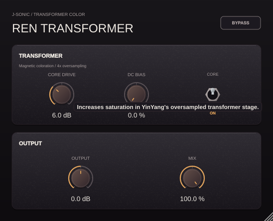

# Ren Transformer

Ren Transformer isolates YinYang Compressor's transformer and output controls in
an independent J-SONIC plugin, with the same ebony panels, amber knobs, vertical
Core switch, one-sentence hover hints, and 50–120% scalable editor.



The DSP directly includes YinYang's `OversampledTransformer`: 4× oversampling,
magnetic hysteresis, frequency-dependent transformer response, and DC bias.
There is no compressor or sidechain detector. Core Drive spans 0–18 dB and DC
Bias spans 0–100%. The Core switch starts On; Off fades to the latency-aligned
clean path and stops transformer processing to save CPU.

Output spans −24 to +24 dB and applies **before** the transformer, following
YinYang's signal order, so it also affects saturation. Mix blends the colored
and clean paths after that gain; here it controls transformer coloration rather
than compression. Both paths have 64 samples of latency at every sample rate.
Host bypass and the Bypass button return the original input with the same delay.
All six parameters support automation and state restoration. Mono and stereo
layouts are supported.

## Build and test

From the repository root, with CMake 3.22+, C++17 and the platform's JUCE dependencies:

```bash
cmake -S projects/RenTransformer -B build-ren -DCMAKE_BUILD_TYPE=Release
cmake --build build-ren --config Release --target RenTransformer_VST3 RenTransformer_Standalone RenTransformerTests --parallel 2
ctest --test-dir build-ren -C Release --output-on-failure
```

macOS also exposes `RenTransformer_AU`. Bundle output is under
`build-ren/RenTransformer_artefacts/Release/`. Linux binaries require Linux hosts.
To regenerate the native tooltip preview on Linux:

```bash
xvfb-run -a build-ren/RenTransformerTests --editor "$PWD/projects/RenTransformer/Previews/ren-transformer-tooltip.png"
```

See [TOOLTIPS.md](TOOLTIPS.md) and [Tests/REPORT.md](Tests/REPORT.md).
