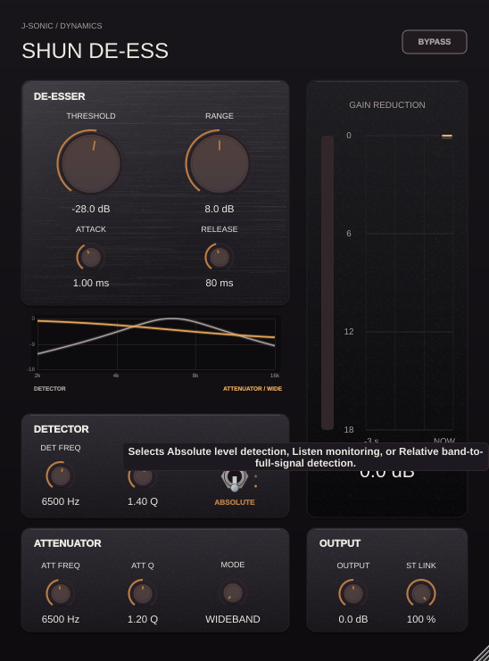

# SHUN DE-ESS hover hints

| Control | Hover hint |
| --- | --- |
| Mode | Selects Wideband, Split, Brilliant, or Smooth de-essing. |
| Bypass | Bypasses de-essing for a direct comparison. |
| Detector mode | Selects Absolute level detection, Listen monitoring, or Relative band-to-full-signal detection. |
| Detector frequency | Sets the frequency emphasized by the sibilance detector. |
| Detector Q | Adjusts detector focus or spectral averaging, depending on the mode. |
| Attenuator frequency | Sets the center of the frequency region being attenuated. |
| Attenuator Q | Adjusts how narrowly attenuation focuses around the selected frequency. |
| Threshold | Sets the detector level in Absolute or the band-to-full-signal difference in Relative. |
| Range | Limits the maximum amount of sibilance attenuation. |
| Attack | Sets how quickly attenuation engages after sibilance is detected. |
| Release | Sets how quickly attenuation fades after sibilance ends. |
| Output | Adjusts the final output level. |
| Stereo link | Links left and right detection to keep stereo de-essing balanced. |
| Spectrum / response display | Shows the stereo input spectrum from minus 120 to 0 dBFS behind the response curves, with active Brilliant restoration or Smooth suppression bands shaded in gold. |
