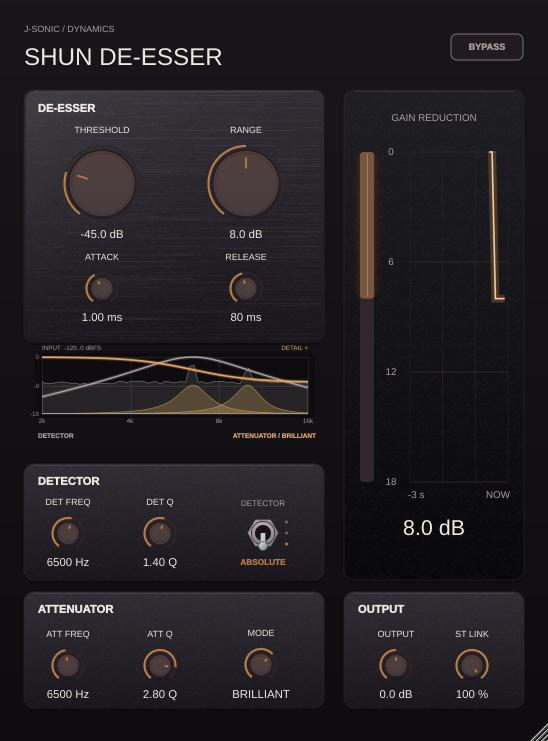
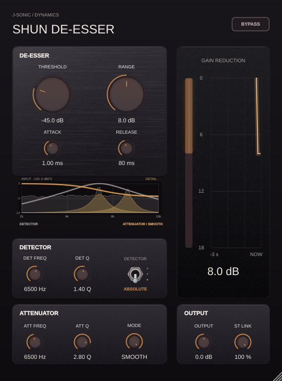

# Shun De-Esser

Only the selected attenuator runs: Wideband uses the shelf, Split-band uses
the bell, and Brilliant/Smooth use the shelf plus detail bands. Detector Listen
suspends the unused attenuators and detail FFT. The input analysis history stays
current and awakened filters are primed from the previous input. Bypass keeps
the selected path hot; detector envelope histories remain live across modes.

Shun De-Esser is a J-SONIC de-esser plug-in project in the Multi-Compressor
repository. It shares the analog panel, rotary control, switch, and meter styling
of Yinyang Compressor while keeping its processor, host parameters, and bundle
identity independent.

The first build provides:

- Four modes on a rotary selector: Wideband, Split-band, Brilliant, and Smooth.
  Brilliant and Smooth analyze a rolling 2–16 kHz FFT and attenuate spectrally
  flat content. Brilliant restores detected detail peaks with narrow bands;
  Smooth reverses that restoration to suppress those peaks further.
- Independent detector frequency/bandwidth and attenuation frequency/Q controls,
  plus threshold and maximum reduction (0–18 dB).
- Attack, release, output, stereo linking, a three-way detector switch, and bypass controls.
- A timestamped three-second gain-reduction trace, a vertical GR meter, and a live stereo input spectrum behind the detector/attenuator curves.
- VST3 and Standalone targets; AU is also enabled when built on macOS.

The vertical detector switch selects **Absolute** for a fixed input-level threshold,
**Listen** to audition the selected sibilance band, or **Relative** to compare
that band's energy with the full signal's energy. In Relative, Threshold sets
the required band-to-full-signal difference in dB, so changes to overall input
level do not change when de-essing begins.

The band-pass detector is normalized to unity at its selected center frequency.
Listen auditions its detector signal. In Brilliant and Smooth, Detector Frequency
weights the FFT analysis region and Detector Q controls temporal spectrum
smoothing; higher Q smooths less. Attenuator Frequency sets the broad cut center,
while Attenuator Q controls the width of the narrow detail bands. The FFT updates
in overlapping windows and drives the zero-latency filterbank. Existing sessions
retain their Wideband, Split-band, or former Smart (now Brilliant) setting.

Editor previews show [Absolute](Previews/shun-de-esser.png) and [Relative](Previews/shun-relative.png) detector modes.
The editor resizes from 50% to 120% with a fixed aspect ratio.
Six examples show the live response plot with different detector/attenuator
settings: [Wideband default](Previews/ResponseExamples/wideband-default.png),
[Wideband high shelf](Previews/ResponseExamples/wideband-high-shelf.png),
[Split tight bell](Previews/ResponseExamples/split-tight-bell.png), and
[Split wide bell](Previews/ResponseExamples/split-wide-bell.png), plus
[Brilliant spectral](Previews/ResponseExamples/brilliant-spectral.png) and
[Smooth spectral](Previews/ResponseExamples/smooth-spectral.png).

## Spectrum and detail display

The response plot overlays a live **2–16 kHz input spectrum** in grey behind
its detector and attenuator curves. Spectrum height uses a separate **−120 to
0 dBFS** scale; the left-hand 0/−9/−18 dB labels still describe the response
curves. Stereo channel powers combine after the FFT, so anti-phase channels
remain visible. The editor performs two 1,024-point Hann-window FFTs at up to
30 Hz, with fast attack and a 220 ms release; stopped playback fades out.
Closing or hiding the editor stops sample capture and display FFT work, and
a full fixed-size display queue drops telemetry without blocking the audio.

In **Brilliant**, gold detail bands marked **DETAIL +** identify the peaks
being restored after broad attenuation. **Smooth** uses the same selected
bands, marked **DETAIL −**, for additional suppression. Their centres, widths,
and strength come from the actual smart attenuator's selected frequencies,
biquad coefficients, band weights, and effective attenuation amount. The
shading now follows the digital filter's power response, avoiding the wide
tails of the previous analog amplitude approximation. Both Q controls have a
maximum of 4; near 6.5 kHz at 48 kHz, the detail filter's −3 dB bandwidth is
about 4.65 kHz at the default Q 1.2, 2.04 kHz at Q 2.8, and 1.43 kHz at Q 4. Shading is a band
activity indicator, rather than another dB response curve; it clears in bypass
and Listen, and fades when processing stops. Wideband and Split-band retain
the spectrum without smart detail shading.




[Spectrum display test report](Tests/Reports/spectrum-display.md) ·
[Measured detail bandwidth and quiet-spectrum test](Tests/Reports/detail-bandwidth.md).

Regenerate the live mode previews and quiet-signal example with:

```bash
build-shun-deess/ShunDeEsserTests --spectrum-previews projects/ShunDeEsser/Previews/ResponseExamples
```

## Build

From the repository root, configure and build the VST3:

```bash
cmake -S projects/ShunDeEsser -B build-shun-deess -DSHUN_DE_ESSER_BUILD_TESTS=OFF
cmake --build build-shun-deess --target ShunDeEsser_VST3 --parallel 4
```

To include the processor checks, leave tests enabled (the default) and run:

```bash
cmake -S projects/ShunDeEsser -B build-shun-deess
cmake --build build-shun-deess --target ShunDeEsserTests --parallel 4
ctest --test-dir build-shun-deess --output-on-failure
```

Regenerate the response examples without running the processor checks:

```bash
build-shun-deess/ShunDeEsserTests --response-previews projects/ShunDeEsser/Previews/ResponseExamples
```

Run the deterministic detector/attenuator mock-signal test and write its
Markdown report, measured Brilliant attenuator-Q and detector-Q sweeps, phase plot,
and rolling attenuator-shape heatmaps at Q 0.5, 1.2, 2.8, and 4.0. The rolling
signal includes gated high-pass noise pulses to mimic sibilant consonants and
compares pulse attenuation with the quiet baseline:

```bash
build-shun-deess/ShunDeEsserTests --analysis-report projects/ShunDeEsser/Tests/Reports/detector-attenuator-mock-report.md
```

The committed example report is at
[Tests/Reports/detector-attenuator-mock-report.md](Tests/Reports/detector-attenuator-mock-report.md).
Its plotted versions are available as [PNG](Tests/Reports/detector-attenuator-mock-report.png)
and [PDF](Tests/Reports/detector-attenuator-mock-report.pdf). Regenerate both from
the report and measured spectrum data with:

```bash
python3 projects/ShunDeEsser/Tests/generate_analysis_report.py
```

The generator also writes `Tests/Reports/wide-split-pulse-test-report.png` and
`Tests/Reports/smart-detector-q-report.png`, with matching PDF reports.

JUCE is provided by the parent repository. For system requirements, see the
root [README](../../README.md).
