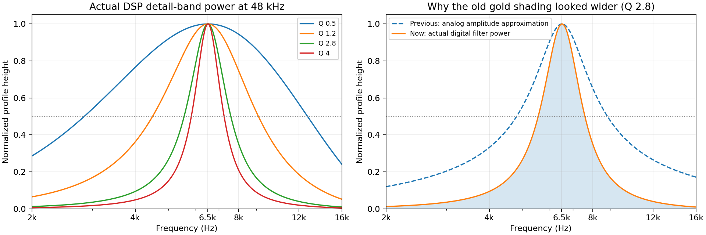
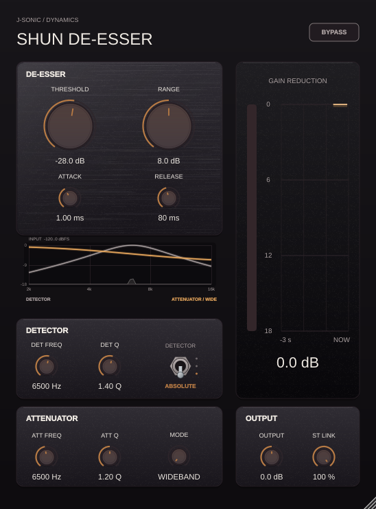

# SHUN detail bandwidth and low-level spectrum

The detail filters are genuinely broad at low Q. The previous display made
those bands look broader again: it used an analog amplitude approximation
instead of the digital filters' power response. The audio filter bandwidth
has not changed in this update.



## Measured bandwidth

These measurements use the coefficients of a filter actually selected by the
smart processor for a 6.5 kHz test tone at 48 kHz. Its selected FFT-bin centre
is 6,515.6 Hz. Band edges are the half-power points (−3 dB).

| Attenuator Q | Lower edge (Hz) | Upper edge (Hz) | Width (Hz) |
| --- | ---: | ---: | ---: |
| 0.5 | 2,842.1 | 12,705.2 | 9,863.1 |
| 1.2 | 4,493.5 | 9,139.8 | 4,646.2 |
| 2.8 | 5,553.6 | 7,596.3 | 2,042.7 |
| 4 | 5,827.8 | 7,262.1 | 1,434.2 |

The default Attenuator Q is 1.2, so a roughly 4.65 kHz band is expected here.
Q 4 narrows it to about 1.43 kHz. Both Detector Q and Attenuator Q already had
a maximum of 4; a shared limit now keeps their host ranges and DSP clamps
consistent. This update does not change defaults or de-essing behavior.

The old analog approximation also overestimated the digital bandwidth,
especially near Nyquist. Its amplitude tails made the gold area look wide:
half height corresponded to −6 dB. Gold shading now uses the exact digital
power response, where half height corresponds to −3 dB, and ends at Nyquist.
Actual low-level filter tails remain represented, with less visual emphasis.
Gold height is still an activity indicator weighted by the smart processor's
band strength, rather than another calibrated dB response curve.

## Low-level spectrum

The spectrum floor moves from **−84 to −120 dBFS**, adding 36 dB of display
range. The upper limit stays at 0 dBFS and the frequency span at 2–16 kHz.
The detector/attenuator curves retain their separate 0 to −18 dB scale.



A −100 dBFS, 6.5 kHz tone, with the right channel opposite in polarity, must
render above the new floor. This was below the former display floor. Stereo
powers still combine after the FFT, preserving anti-phase visibility.

## Validation

- The plotted response matches the impulse response of each published audio
  biquad at three frequencies within 0.00002 absolute power error.
- Bandwidth tests cover Q 0.5/1.2/2.8/4 at 8/44.1/48/96 kHz and require
  monotonically narrower bands with higher Q.
- Both host Q controls expose a maximum of 4.
- The quiet-tone image check requires visible pixels above the plot baseline.
- Existing spectrum, bypass, audio-invariance, queue-overflow, editor scaling,
  tooltip and automation regressions remain part of the test suites.

Data: [detail-bandwidth.csv](detail-bandwidth.csv),
[detail-responses.csv](detail-responses.csv).

Reproduce:

```bash
ShunDeEsserTests --spectrum-previews /tmp/shun-previews
# Copy the two measured CSV files to this Reports directory, then:
python3 projects/ShunDeEsser/Tests/generate_spectrum_report.py
```
