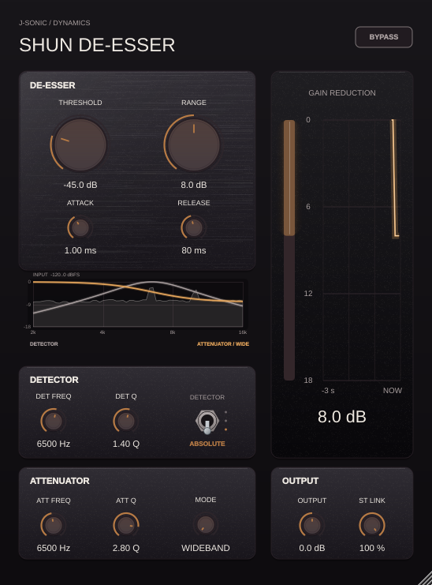
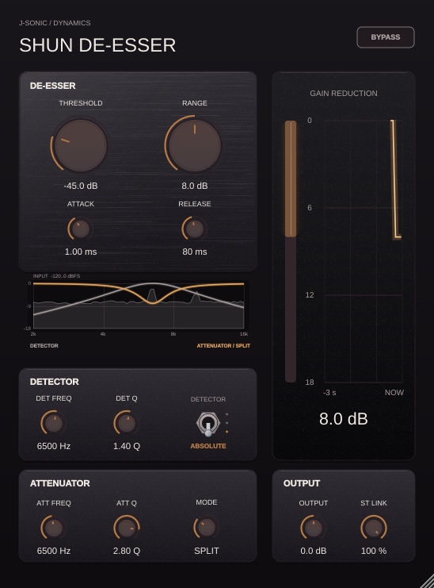

# SHUN spectrum and smart-detail display

See [measured detail bandwidth and quiet-signal validation](detail-bandwidth.md)
for the corrected digital-power shading and expanded −120 dBFS floor.

The response display now overlays a live stereo input spectrum with gold
activity bands from the actual smart attenuator. Rendering keeps the Ebony
palette and existing response controls.

| Mode | Spectrum | Gold detail activity |
| --- | --- | --- |
| Wideband | 2–16 kHz input, −120 to 0 dBFS | None |
| Split-band | Same | None |
| Brilliant | Same | Selected peaks restored, labeled DETAIL + |
| Smooth | Same | Selected peaks suppressed, labeled DETAIL − |





## Validation

The full processor/editor suite passes 419 checks; Linux VST3 and Standalone
builds also pass. The dedicated `--spectrum-previews` run passes 260 checks, using seeded noise
and gated 6.5/10 kHz tones with the right channel opposite in polarity.

- Visible/hidden processor comparisons in all four modes stay within 0.0000001
  sample error, including deliberately filling the display queue beyond capacity.
- Stereo samples retain both channels; their FFT powers combine after analysis,
  so anti-phase input appears in each rendered spectrum instead of canceling.
- The smart telemetry selects the actual 6.5 kHz detail band with nonzero DSP
  weight and effective attenuation; previews use those live selections.
- Image checks require the spectrum to alter the response plot in every mode,
  and active gold shading to disappear in bypass in Brilliant and Smooth.
- Stopped playback fades the display, and headless processing captures no
  spectrum samples. Bypass clears detail activity.

The input FFT uses 1,024-sample Hann windows on the editor thread at up to
30 Hz. The audio callback only copies into a fixed, nonblocking queue and
publishes a fixed-size detail snapshot; this adds no display FFT, allocation,
or GUI lock to the audio callback. Shading indicates active band location,
width, and strength, not a second calibrated dB response curve. Spectrum
height and response-curve height use the separately labeled scales.

Reproduce from a configured JUCE build:

```bash
ShunDeEsserTests --spectrum-previews projects/ShunDeEsser/Previews/ResponseExamples
ShunDeEsserTests --editor /tmp/shun-editor.png
```
