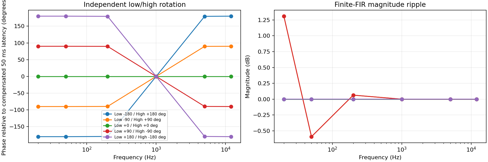
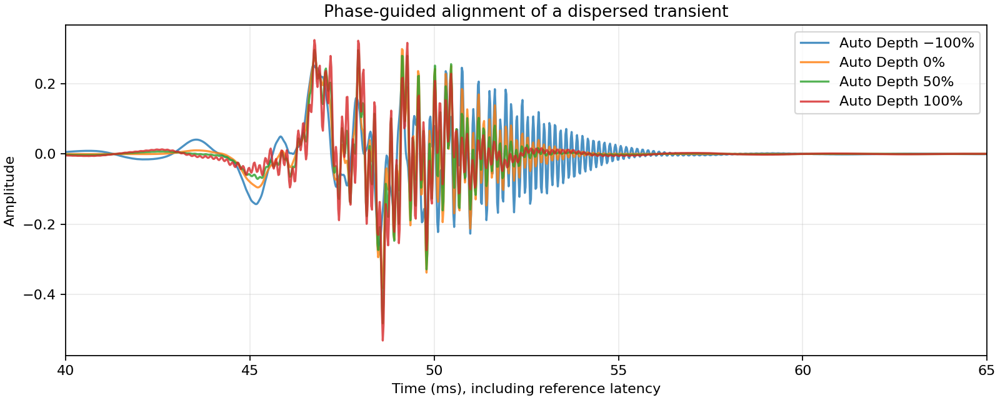
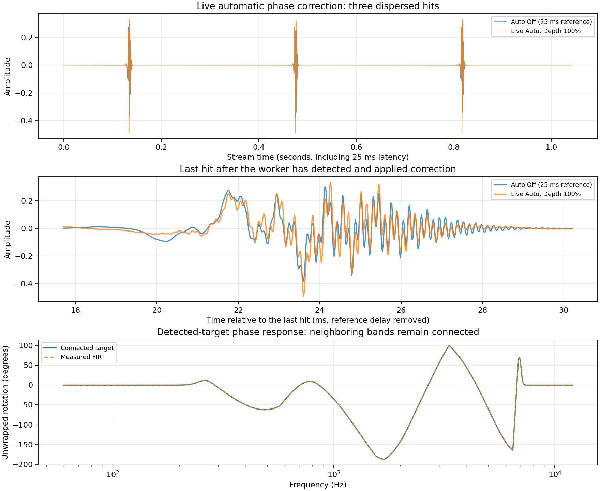
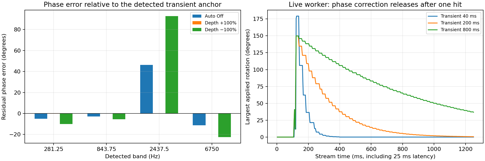
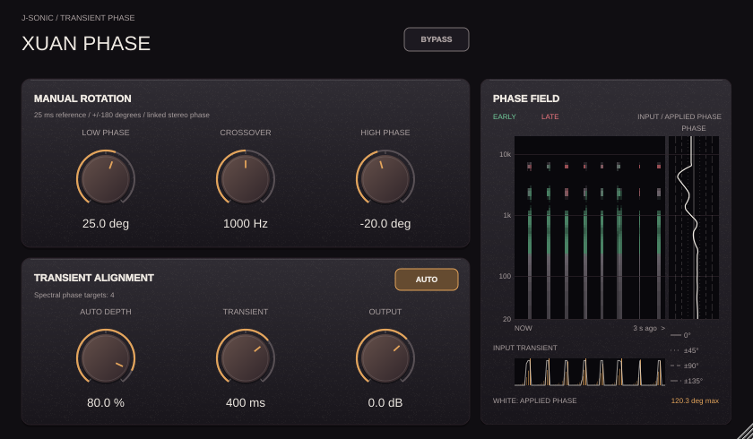

# Xuan Phase test report

## Manual controls and latency

The same FIR used by the processor is measured at 20, 50, 200, 1k, 5k and
12k Hz for opposite low/high settings, with a 1 kHz crossover. Phase is measured
relative to the 25 ms reference. The endpoints reach approximately ±180° at
20 Hz; intermediate-angle magnitude ripple is shown explicitly. The response
is a finite phase-rotation approximation, not a mathematically exact all-pass.

Impulse tests compare the actual hybrid convolution against its designed FIR,
check block-size invariance at 1 and 127 samples, stereo linking, and neutral
and bypass delays at 8/44.1/48/96/192 kHz. Host state recall covers all eight
parameters. Input/output latency stays round(sampleRate × 25 ms) samples.

## Transient spectral phase and Depth

Four Gaussian wave packets at 281.25, 843.75, 2437.5 and 6750 Hz have staggered
centres. Their measured spectrogram phases and slopes generate narrow-band
targets. The actual audio convolution then runs at Depth −100/0/50/100%.
This deterministic test freezes the detected target before rendering, separating
the phase algorithm's effect from real-time worker scheduling. The reference
delay is included in every trace. No output gain or loudness normalization is
applied; both RMS and crest are reported to expose magnitude changes.

| Auto Depth | Peak | RMS over the full 7,000-sample buffer | Crest factor |
| --- | ---: | ---: | ---: |
| −100% | 0.272990 | 0.028242 | 19.705 dB |
| 0% | 0.382388 | 0.028242 | 22.632 dB |
| 50% | 0.483089 | 0.028242 | 24.663 dB |
| 100% | 0.532231 | 0.028242 | 25.504 dB |

Depth 0 is sample-identical to manual-only processing. Full Depth must improve
the dispersed hit's peak by at least 5% in this test. Detected group-delay
corrections are bounded to ±25 ms; stationary noise must not repeatedly trigger
new targets. A separate streamed three-hit test exercises the real worker,
response handoff and stereo linking; host bypass is checked with nonzero
rotation and output gain. Peak improvement on this constructed signal is not a guarantee
for arbitrary recordings. Native editor checks cover parameter binding, hover
hints and the 50%–120% resize limits.

## Live automatic phase-shifting case

This additional case feeds three repeated dispersed hits into the **real processor
and analysis worker** at 48 kHz in 128-sample blocks, starting with no detected
targets. Auto is On at 100% Depth with the default 200 ms Transient release;
Low Phase, High Phase, and Output are all zero.
The block loop gives the background worker 3 ms per block; scheduling can affect
the first hit. Auto Off is the identical input delayed by the fixed 25 ms.
No target is preloaded, and no gain compensation or normalization is applied.

| Hit | Auto Off peak | Live Auto peak | Peak increase | RMS change |
| --- | ---: | ---: | ---: | ---: |
| 1 | 0.382388 | 0.490522 | 28.3% | +0.0003 dB |
| 2 | 0.382388 | 0.490522 | 28.3% | +0.0003 dB |
| 3 | 0.382388 | 0.490522 | 28.3% | +0.0006 dB |

Each RMS window spans 4,096 samples including the complete hit and response tail.
Tests require the last hit's peak to improve by at least 5% while RMS stays within
2% of the reference. This demonstrates automatic phase shifting on a deliberately
dispersed signal; arbitrary source material may improve less or lose peak level.
Listen at the same playback level: [Auto Off](auto-off.wav), [Live Auto](auto-on.wav).

The response subplot measures the deterministic detected-target FIR used in the
Depth test above, rather than pretending a time-varying stream has one fixed
transfer function. Adjacent targets now interpolate their local phase/delay
curves with a smoothstep blend instead of fading to zero between Gaussian peaks.
Angles unwrap before interpolation across +/-180 degrees; only the outside edges
taper to neutral. Regression checks cover gaps, wrapped angles, continuity at
every detected target, and connected timing colors. Spectrogram energy still
shows real spectral gaps, since absent input frequencies must remain dark.

A separate broadband-onset regression contains over 24 spectral peaks and
requires the 24 selected targets to include both sub-1 kHz and above-16 kHz
content. Selection reserves the strongest peak in each logarithmic region,
then fills remaining slots by strength, rather than taking the first 24
low-frequency peaks. Coverage now extends to 20 kHz (limited to 45% of the
sample rate).

## Alignment accuracy, reverse Depth, and Transient release

At each detected spectral peak, residual error is the measured FIR rotation
minus the required rotation toward the common transient anchor, wrapped to
±180°. This directly measures phase alignment in addition to comparing peaks.
The deterministic response is frozen at full correction to isolate the alignment
objective from worker timing and release. Intermediate frequencies follow the
connected curve; this table measures the four detected peaks only.

| Auto Depth | Mean absolute residual error | Largest absolute residual error |
| --- | ---: | ---: |
| Off | 16.348° | 46.406° |
| +100% | 0.048° | 0.189° |
| −100% | 32.743° | 92.812° |

Negative Depth reverses the correction: on this constructed hit it doubles the
phase error and reduces the peak, while positive Depth moves the detected bands
toward the shared anchor. RMS remains approximately equal. This is a creative
reverse-alignment control, not a guarantee of lower peak for every input.

The release plot uses a separate **live-worker** single-hit stream, with Depth
−100% to also verify that negative settings activate analysis. It measures the
actual applied FIR response through audio telemetry, including kernel handoffs
and crossfades, at Transient 40/200/800 ms. Time follows processed audio samples,
so offline rendering speed does not change the envelope. Release is exponential:
after one selected time constant, 36.8% of the last correction remains; after
about seven time constants, the response returns to manual-only processing.
The release starts after the last detected onset frame, rather than the first
sample of the hit. Rebuilds occur at up to 50 Hz during release and use the
existing 5 ms response crossfade; the plotted envelope includes that stepping.

| Transient | Largest applied rotation during test | Rotation at end of 1.25 s stream |
| --- | ---: | ---: |
| 40 ms | 179.183° | 0.000000° |
| 200 ms | 149.858° | 0.551981° |
| 800 ms | 149.858° | 36.785600° |

The short release must return below 1°; the long release must retain more
correction than the medium release. Other checks cover zero Depth, host bypass,
linked stereo, fixed latency, state recall of all eight parameters, 24-band
coverage into the high frequencies, and no repeated triggers on stationary noise.

These are reproducible synthetic cases, not a listening benchmark for all music.
The method prioritizes a detected transient anchor; conflicting components,
polyphonic material, low-frequency resolution, finite-FIR magnitude ripple,
and worker scheduling can limit improvement. Higher peak at unchanged RMS is a
punch indicator, not proof of perceived quality or reconstruction of an original
undispersed source.

## Phase-field display

The native editor test streams repeated dispersed hits through the real processor
and worker, observes transient events and both signed timing directions, and
checks that non-empty image columns move from left to right across the
three-second history. The history is 168 px wide beside a 56 px applied-phase
track, with styled guides and a key for 0°, ±45°, ±90°, and ±135°. Green indicates an
early input band and red a late input band. The white curve uses the measured
complex FIR response: tests compare it with an independent DFT, ensure queued
responses do not appear before audio applies them, verify updates after handoff,
and check zero displayed phase under host bypass. Input analysis remains live
with Auto Off while the meter is visible, and stops when the editor is hidden.
The meter stays inside the editor at both scaling limits. Its phase trace uses
shape-preserving cubic interpolation between measured points, without overshoot,
and splits at the ±180° wrap instead of drawing a line across the entire track.
Output sits at the far right of the three-knob Auto row beside Transient.

Data: [phase.csv](phase.csv), [transient.csv](transient.csv), [auto-live.csv](auto-live.csv), [auto-phase.csv](auto-phase.csv).
