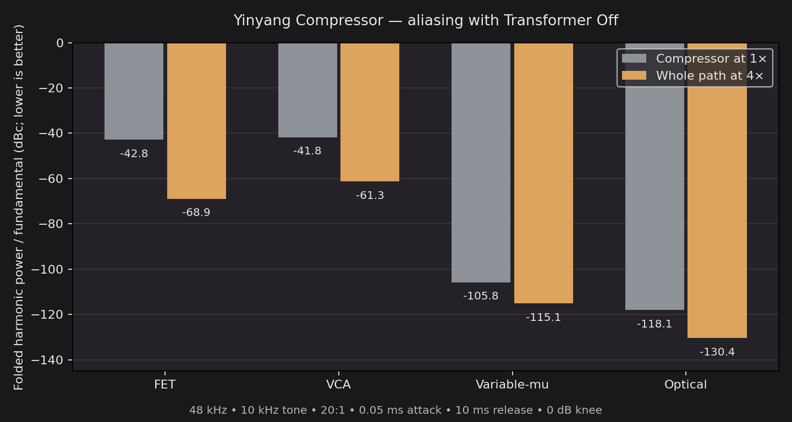

# Yinyang Compressor: whole-path 4× oversampling

Measured 2026-10-24 with the production C++ DSP.

The single 4× converter now surrounds input gain, detector HPF/High Tilt,
envelopes, compression, M/S processing, wet/dry mix, output gain, and transformer.
Control time constants are computed at the internal rate. The transformer uses
its core directly, so enabling it keeps processing at 4×. Two 257-tap polyphase
FIR filters retain the existing **64 host-sample latency**, including at 8,
44.1, 48, 96, and 192 kHz. Inactive models and Transformer Off still sleep.
Selected DSP stays hot through both host and parameter bypass; bypass returns
exactly delayed original input. Zero Mix now returns the FIR-band-limited dry
signal, with the same alignment as the wet path.

## Aliasing with Transformer Off

A coherent 10 kHz sine, peak 0.8, is processed at 48 kHz using 20:1 ratio,
−30 dB threshold, 0 dB knee, 0.05 ms Attack, 10 ms Release, full wet mix, and no
sidechain HPF or High Tilt. The first 250 ms are discarded; the final 250 ms
are measured. The 1× reference runs the same current equations directly at
48 kHz. The 4× path runs them at 192 kHz and downsamples once.

The summed power at 18, 2, 22, 6, and 14 kHz measures the distinct folded bins
of the 3rd–11th harmonics. Levels are normalized to the output fundamental,
so a change in overall gain cannot masquerade as improved alias rejection.
These results describe those bins for this tone and setting. Variable-mu and
optical already have very low alias levels in the reference.

| Model | 1× alias power (dBc) | Whole-path 4× (dBc) | Reduction (dB) |
| --- | ---: | ---: | ---: |
| FET | -42.82 | -68.90 | 26.09 |
| VCA | -41.76 | -61.31 | 19.55 |
| Variable-mu | -105.75 | -115.09 | 9.34 |
| Optical | -118.05 | -130.43 | 12.38 |



[Raw alias measurements](oversampling.csv).

## CPU cost

Local Linux/GCC `-O3`, stereo 48 kHz, 128-sample host blocks; each row is the
median of three passes over 250 ms of identical audio. Preparation and input
creation are excluded. The previous implementation is commit `6bb06670f3`.
The production benchmark source is [PerformanceBench.cpp](../PerformanceBench.cpp).
Results depend on hardware, compiler, and host scheduling.

| Transformer | Model | Before (ms) | Whole-path 4× (ms) | Ratio |
| --- | --- | ---: | ---: | ---: |
| Off | FET | 1.72 | 13.75 | 7.97× |
| Off | VCA | 1.74 | 13.52 | 7.75× |
| Off | Variable-mu | 2.59 | 18.99 | 7.32× |
| Off | Optical | 2.19 | 14.73 | 6.72× |
| On | FET | 15.76 | 19.12 | 1.21× |
| On | VCA | 16.36 | 19.31 | 1.18× |
| On | Variable-mu | 17.62 | 23.67 | 1.34× |
| On | Optical | 16.92 | 20.11 | 1.19× |

The Off comparison now includes FIR conversion that the previous implementation
skipped. With the transformer already enabled, its existing converter is reused
for the complete compressor. Unused `pow(x, 1)` work is also skipped when
VariTransient does not change an envelope coefficient.

[Raw CPU measurements](oversampling-cpu.csv).

## Validation and reproduction

- Four Yinyang CTest suites pass: DSP behavior, host integration, Yin gain/rate
  behavior, and the new whole-path oversampling checks.
- Checks cover all models, mono/stereo, arbitrary block partitions, finite extreme
  settings, inactive detector suspension, exact bypass, FIR impulse symmetry and
  latency, and internal-rate selection.
- Unity compression plus Transformer On matches one standalone 4× transformer
  within 1e-6 at 44.1/48/96 kHz, verifying there is no nested conversion.
- Before/after standalone transformer output was bit-identical for 16,384 samples
  at each of 44.1/48/96 kHz. Ren's 40 checks and Zao's 3,144 checks also pass.
- Linux VST3 and Standalone builds pass for Yinyang, Ren, and Zao.

```sh
cmake --build /workspace/juce-env/yinyang-build --target YinyangCompressorOversamplingTests
/workspace/juce-env/yinyang-build/YinyangCompressorOversamplingTests \
  projects/YinyangCompressor/Tests/Reports/oversampling.csv
python3 projects/YinyangCompressor/Tests/generate_oversampling_report.py

g++ -O3 -std=c++17 projects/YinyangCompressor/Tests/PerformanceBench.cpp -o /tmp/yinyang-perf
/tmp/yinyang-perf
```
