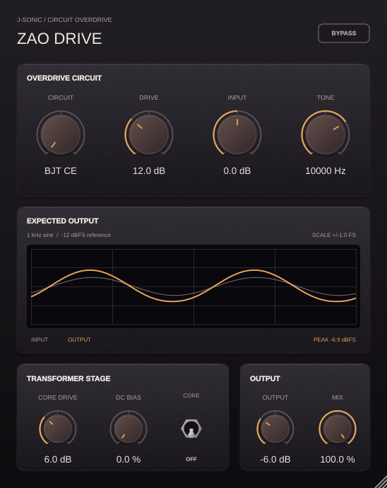

# Zao Drive

Zao Drive is the fourth J-SONIC plugin in this repository, with a common-emitter
BJT overdrive and an op-amp feedback diode clipper. It shares YinYang, Shun,
and Kuo's ebony panels, amber controls, flip switch, and 50%–120% scalable UI.



An [op-amp mode preview](Previews/zao-opamp.png) shows the feedback clipper with
the output transformer enabled.

The **Circuit** knob selects BJT CE or OPAMP FB. Input adjusts the level entering
the circuit, Drive adds up to 36 dB of excitation, and Tone filters the circuit
output from 1.2–18 kHz. Mix blends with the original input after latency alignment;
Output sets the level entering the optional transformer.

The **Expected Output** display renders a −12 dBFS, 1 kHz reference through a
separate instance of the actual audio engine. Gray is the delayed input and amber
is the predicted output, including Tone, Mix, Output, bypass, and transformer
settings. It is a reference waveform, not a live oscilloscope or a prediction of
arbitrary input material. The plot starts at ±1 FS and expands its labeled scale
for higher output levels. Rendering runs on the message thread without sharing
circuit state or locks with the audio callback.

The optional **Transformer Stage** directly includes YinYang's
[`OversampledTransformer`](../CharacterCompressor/Source/OversampledTransformer.h)
class. Core Drive and DC Bias have the same behavior, including hysteresis,
frequency response, and filtering of generated distortion. The transformer
stops processing once its Off fade finishes; re-enabling warms its delay before
fading in. Circuit processing uses a separate 4× oversampler. Host latency is the
integer circuit oversampler delay plus the transformer's fixed 64 samples and
stays constant with either model, Mix, bypass, or transformer switching.

All controls have one-sentence hover hints, listed in [TOOLTIPS.md](TOOLTIPS.md).

## Circuit models

These are numerical circuit models with explicit nominal component values, not
generic transistor-shaped transfer curves. Their accuracy is relative to the
specified equations and components; they are not calibrated reproductions of a
particular transistor, pedal, or op-amp IC. See [CIRCUITS.md](CIRCUITS.md) for the
topologies, device parameters, integration method, and model limits.

- **BJT CE:** a 9 V biased common-emitter stage, with source impedance, input
  coupling capacitor, loaded bias divider, collector resistor, split emitter
  resistors, and emitter bypass capacitor. A charge-based Ebers–Moll transistor
  includes forward/reverse current gain, both junctions, Early modulation,
  voltage-dependent depletion capacitance, and diffusion charge. Newton solves
  all four circuit nodes at every oversampled step. Its physical inversion is
  corrected at the output so parallel mixing retains polarity.
- **OPAMP FB:** a non-inverting amplifier with a 4.7 kΩ ground leg and 47 kΩ
  feedback leg. Antiparallel Shockley diodes and a 51 pF capacitor sit inside the
  feedback loop. The solve includes 100 dB open-loop gain, a 3 MHz gain-bandwidth
  product, ±4 V output rails, and a 1 V/µs slew limit.

Both circuits keep independent left/right states. Parameters are smoothed;
changing circuit crossfades over 10 ms, and the inactive circuit then stops
processing. No allocation, mutex, file I/O, or preview rendering occurs in the
audio callback.

## Build and test

From the repository root:

```bash
cmake -S projects/ZaoDrive -B build-zao -G Ninja -DCMAKE_BUILD_TYPE=Release
cmake --build build-zao --target ZaoDrive_VST3 ZaoDrive_Standalone ZaoDriveTests --parallel 2
ctest --test-dir build-zao --output-on-failure
```

The VST3 bundle is under `build-zao/ZaoDrive_artefacts/Release/VST3/`.
AU is enabled when configuring on macOS. Use an appropriate CMake generator
and toolchain for Windows/macOS; the Windows workflow is unchanged.

Capture a native editor preview on Linux with:

```bash
xvfb-run -a build-zao/ZaoDriveTests --editor /tmp/zao-drive.png
xvfb-run -a build-zao/ZaoDriveTests --editor /tmp/zao-tooltip.png --tooltip
```

The tests check circuit residuals through cutoff/saturation, current conservation,
op-amp rail limits and symmetry, harmonic differences, host state recall, latency,
bypass/dry exactness, stereo isolation, and sample-for-sample transformer parity
with YinYang. Editor checks cover the waveform display, host controls, hover hints,
and both resize limits.

Generate the [circuit report](Tests/Reports/report.md) and standalone plots:

```bash
build-zao/ZaoDriveTests --report "$PWD/projects/ZaoDrive/Tests/Reports"
python3 projects/ZaoDrive/Tests/generate_report.py
```

Report plotting needs NumPy, SciPy, and Matplotlib; building the plugin does not.
