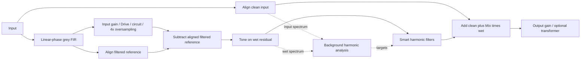

# Smart harmonic processing

Smart is the host-automatable button beside **Overdrive Circuit**, default Off.
It shapes the generated wet signal; it never adjusts Drive, Bias, Knee, Input,
Tone, or the physical circuit equations. Existing presets load Smart Off.



For aligned clean input `x`, aligned filtered reference `g`, and circuit output
`d` driven from that filtered signal, the wet branch is `r = Tone(d − g)`.
Smart applies harmonic shaping `H` to this branch, then
`y = x + Mix × H(r)` before Output and the optional transformer. At Mix 0%,
only the clean branch reaches the output stages. Smart Off makes `H` the identity.
The clean branch includes the grey FIR's delay plus the circuit oversampler's
integer delay; the filtered reference needs only the latter delay. The output
stages retain the existing transformer compensation delay. The grey curve uses the
ISO 226:2003 equal-loudness contour at 80 phons, referenced to 1.5 kHz. Only
upward gain is capped at +3 dB; the contour's negative gains are retained.
A symmetric FIR keeps its added phase strictly linear; filter length scales with
sample rate to hold approximately 2.67 ms delay (128 samples at 48 kHz). See the
[grey filter report](Tests/Reports/grey-report.md) for its measured response.

The subtraction is a driver-minus-filtered-reference residual, not a perfect harmonic
separator: circuit gain, frequency response, phase, inversion correction and
compression can leave fundamental components in the residual. Oversampler
integer alignment does not invert its complete frequency-dependent response.
This is why the detector also protects frequencies already present in the input.
Tone now filters the residual instead of the entire driver output, so Tone's
sound changes for existing presets even with Smart Off. The clean branch stays
independent of Tone and Smart. Output and an enabled transformer still affect
the recombined signal.

## Analysis and interval score

A 4096-sample Hann window compares the stereo input and actual wet residual.
Left/right powers are averaged rather than summing audio, preserving anti-phase
stereo. The analyser keeps up to 24 prominent input peaks from 40 Hz to 12 kHz,
refines their frequencies by log-parabolic interpolation, and requires those
peaks to explain at least half of the input spectrum's power. Silence and
unpitched noise therefore produce a neutral result.

For each input partial `f`, orders `n = 2…12` predict candidate frequencies
`h = n × f` below 0.43 times the sample rate. The wet spectrum supplies their
measured energy, rather than a modeled sine-wave transfer-function estimate.
Candidates within four bandwidths of an existing input peak are protected.
Other candidates must have energy at least 40 dB below the wet spectral maximum.

For a candidate harmonic `h`, the score is the input-amplitude-weighted average
of `D(h, input partial)` across the detected input spectrum. `D` maps
`12 × abs(log2(fa/fb))` into an octave, then interpolates the supplied qualitative
sensory-dissonance graph with smooth transitions. Unison, minor/major thirds,
fourth, fifth, major sixth and octave form valleys; near-unison intervals score
higher. Wider octave separation reduces the cost. The image provides a shape,
not calibrated measurements, so this is an explicit 12-TET approximation and a
musical heuristic rather than a universal perceptual clarity measure.

The requested cut is `−min(6, 18 × score)` dB. At most 16 non-overlapping
candidates with the largest predicted reduction of dissonance-weighted harmonic
energy become filters. Bandwidth is the larger of 1.5 FFT bins or 1.8% of the
harmonic frequency. The audio path uses causal RBJ peaking cuts on the wet
residual. It does not reduce overall drive or normalize the signal to make its
score smaller. Local filtering can also affect nearby wet components; shared
spectral bins and polyphonic intermodulation cannot be uniquely attributed to
individual harmonic orders. This is targeted suppression, not independent
resynthesis of every harmonic.

## Scheduling and transitions

Analysis runs on a low-priority worker after the first full frame and at most
four times per second thereafter. A preallocated single-owner job slot and
atomic result publication let the audio callback skip a busy worker without
waiting. No FFT, circuit search, allocation, or mutex runs in that callback.
The callback processes at most two banks of 16 biquads during a transition.
Stereo channels use identical targets and independent filter states.

Each new bank crossfades over 50 ms. Turning Smart Off fades to the neutral bank,
then stops spectral jobs and harmonic filters. Bypass and Mix 0% also suspend
analysis. Manual circuit changes invalidate earlier results. Smart adds no
buffered latency; its first decision needs approximately 85 ms of audio at
48 kHz plus worker scheduling time. Analysis cadence affects response time,
not host-reported latency.

The expected-output display applies the current live filter snapshot to its
1 kHz reference using an independent engine without a worker. It is not a live
oscilloscope, and its reference tone does not determine the live filter targets.

## Validation

See the [measured report](Tests/Reports/smart-report.md), its
[PDF](Tests/Reports/smart-report.pdf), and the
[native Smart preview](Previews/zao-smart.png). Regenerate with:

```bash
build-zao/ZaoDriveTests --smart-report "$PWD/projects/ZaoDrive/Tests/Reports"
python3 projects/ZaoDrive/Tests/generate_smart_report.py
xvfb-run -a build-zao/ZaoDriveTests --editor "$PWD/projects/ZaoDrive/Previews/zao-smart.png" --smart-preview
```
