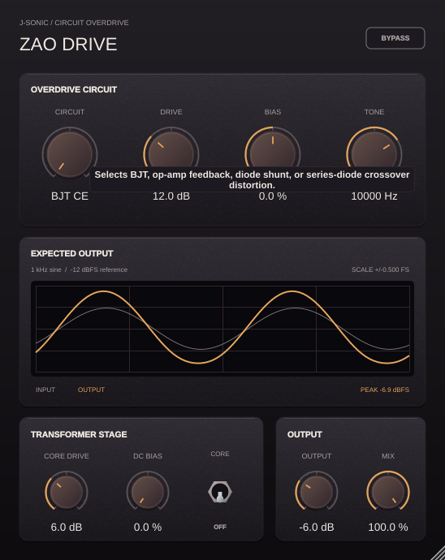

# Zao Drive hover hints

| Control | Hover hint |
| --- | --- |
| Circuit | Selects BJT, op-amp feedback, diode shunt, or series-diode crossover distortion. |
| BJT Bias | Shifts the BJT base-bias voltage away from its nominal operating point. |
| Diode Knee | Increases amplifier output impedance and softens current delivery into the Schottky diodes. |
| Op-Amp Input | Adjusts the level entering the selected overdrive circuit. |
| Drive | Increases the signal driving the selected transistor, op-amp, or diode circuit. |
| Tone | Sets the low-pass cutoff after the overdrive circuit. |
| Output | Adjusts gain after the wet and dry mix and before the output transformer. |
| Mix | Blends the overdriven signal with the latency-aligned original input. |
| Core drive | Increases saturation in the enabled output transformer. |
| DC bias | Adds transformer asymmetry to increase even harmonics. |
| Transformer | Saves CPU when Off; adds YinYang's transformer coloration when On. |
| Bypass | Bypasses the overdrive and transformer while preserving plugin latency. |
