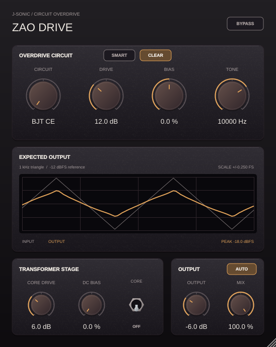

# Zao Drive Auto reference-level compensation



Auto uses a **fixed correction from the rendered preview waveform's RMS**.
There is no live-input RMS detector, moving average, attack/release envelope or
signal-dependent gain tracking. It matches the 1 kHz triangle preview reference
at Output 0 dB; other Output values add or subtract gain from that matched level. Live
music keeps its dynamics and receives the same fixed gain between reference
updates. The audio path and display use one shared reference calculation.

## Calculation and signal path

The worker renders the same −12 dBFS, 1 kHz triangle reference and existing 4,096-sample
warmup as the display. The triangle retains the previous ±0.25 FS peak
and 48-sample period at 48 kHz. It measures the 96-sample, two-cycle input
and processed output snapshot after Clear, the circuit, Tone, Mix, Output and the transformer:

```text
reference gain = sqrt(sum(preview input²) / sum(uncompensated preview output²))
output = processed audio × reference gain × 10^(Output dB / 20)
```

The correction uses the rendered target snapshot, not the display's interpolated
animation frames. Auto is applied after the transformer and before the host
bypass crossfade. Both stereo channels use one gain, so stereo balance is
preserved. Output still sets the level entering the transformer, retaining its
coloration behavior; Auto corrects its resulting reference level and then applies
the knob value as a final trim. Thus −12 dB, 0 dB and +6 dB produce those RMS
offsets from the preview input. Auto Off retains the original signal path.
The trim fades on Auto switching and follows the existing 20 ms Output smoothing.
Reported latency does not change.

The processor owns the reference worker, so calibration works with the editor
closed. Control and Smart-snapshot changes trigger an updated reference, at most
five times per second; unchanged reference settings do not rerender. The worker
rejects snapshots if the controls change during rendering. Audio only reads an
atomic gain and applies it: no FFT, rendering, locks or allocation occurs there.
The worker prepares its separate engine lazily and reuses it.

Only a new correction or an On/Off change fades over 20 ms to avoid clicks.
This is a control transition, not live level averaging. The correction then
remains constant through quiet passages, transients and silence. A silent or
invalid reference uses unity, and correction is bounded to ±36 dB.

## Measurements

The independent reference test uses default Drive/Tone/Mix/Clear settings,
Output −12/0/+6 dB, and every circuit with the transformer both Off and On.
All cases use the display's 48 kHz reference engine. Host sample rate does not
change that reference definition.

| Circuit | Transformer | RMS offset at −12 dB | At 0 dB | At +6 dB | Maximum error |
| --- | --- | ---: | ---: | ---: | ---: |
| BJT CE | Off | -12.000 dB | -0.000 dB | +6.000 dB | 4.293e-07 dB |
| BJT CE | On | -12.000 dB | +0.000 dB | +6.000 dB | 4.467e-07 dB |
| OPAMP FB | Off | -12.000 dB | -0.000 dB | +6.000 dB | 3.188e-07 dB |
| OPAMP FB | On | -12.000 dB | -0.000 dB | +6.000 dB | 8.459e-07 dB |
| DIODE SHUNT | Off | -12.000 dB | -0.000 dB | +6.000 dB | 3.309e-07 dB |
| DIODE SHUNT | On | -12.000 dB | +0.000 dB | +6.000 dB | 3.335e-07 dB |
| CROSSOVER | Off | -12.000 dB | +0.000 dB | +6.000 dB | 6.575e-07 dB |
| CROSSOVER | On | -12.000 dB | -0.000 dB | +6.000 dB | 3.611e-07 dB |

Data: [auto-rms.csv](auto-rms.csv). Each measured RMS error relative to the requested Output offset is below 1e-5 dB.
These measurements describe the preview-reference criterion, not a promise of
continuous RMS normalization of arbitrary input material.

## Validation

Tests verify fixed compensation at 8/44.1/48/96/192 kHz through input-level
steps, transients, silence and asymmetric/anti-phase stereo. End-to-end tests
compare compensated and uncompensated instances of every circuit, including
the optional transformer: only the published fixed output gain may differ.
Host bypass remains an exact delayed impulse. Separate tests check hidden-editor
calibration, recalculation after Output changes, no gain change from live
content, saved-state recall and legacy Auto-Off migration. Native editor tests
check placement, host automation, negative/zero/positive RMS offsets and preview updates.
Linux Release VST3 and Standalone builds passed. macOS and Windows builds were
not run.

Auto defaults Off, appends a host parameter without changing previous IDs, and
loads Off in older presets. No runtime correction is written into the user's
manual Output parameter or saved as another automation control.

Regenerate measurements and the enabled preview from the repository root:

```bash
build-zao/ZaoDriveTests --auto-report "$PWD/projects/ZaoDrive/Tests/Reports"
xvfb-run -a python3 projects/ZaoDrive/Tests/with_x11_atoms.py \
  build-zao/ZaoDriveTests --editor "$PWD/projects/ZaoDrive/Previews/zao-auto.png" --auto-preview
```
