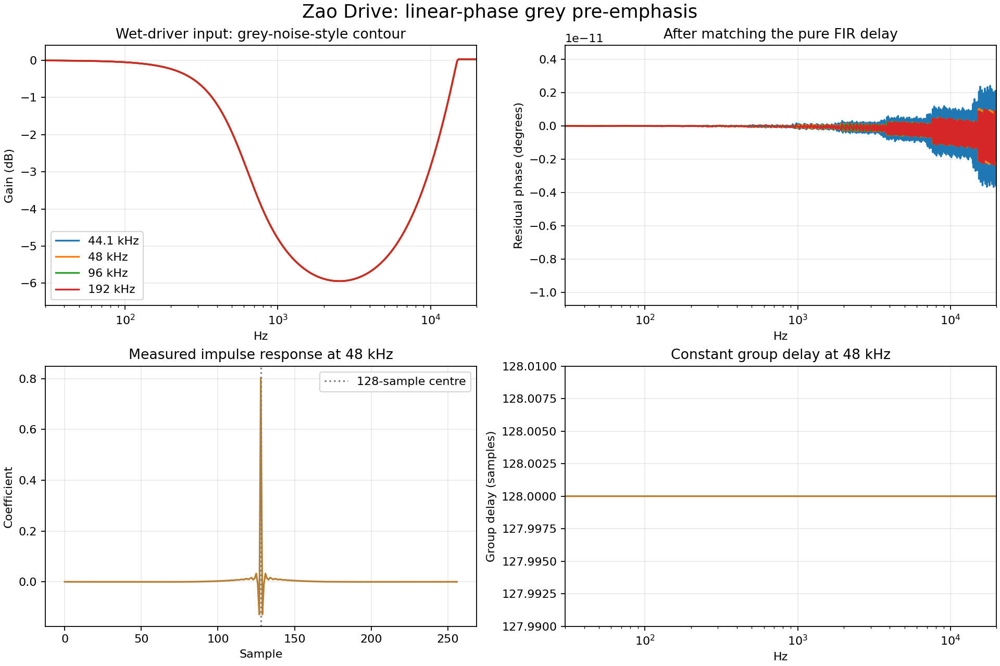

# Zao Drive grey-filter test report



The wet-driver input uses a fixed grey-noise-style contour: a bounded inverse
A-weighting approximation with about 6 dB of midrange reduction around 2–4 kHz,
returning toward unity at bass and upper-treble frequencies. Grey noise depends
on the chosen equal-loudness contour and listening level; this is an explicit,
gentle approximation rather than a universal calibrated grey-noise standard.

A Blackman-windowed, symmetric Type-I FIR implements that contour. Coefficients
are computed during preparation, with no coefficient design or allocation in
the audio callback. The sample-rate-dependent tap count preserves approximately
2.67 ms of delay. At 48 kHz this is 257 taps with a 128-sample group delay.
The runtime exploits tap symmetry and uses independent stereo histories.

## Measurements

The table and plots come from the actual C++ FIR coefficients, independently
analysed with SciPy. Every impulse is exactly symmetric, its response remains
positive after compensating the centre delay, and the maximum residual phase
error is **1.762e-13 radians** across 8192 frequency points per rate.

| Sample rate | FIR taps | Added FIR samples | Added FIR ms | Total plugin samples | Gain at 2.5 kHz |
| ---: | ---: | ---: | ---: | ---: | ---: |
| 8,000 | 43 | 21 | 2.625 | 91 | -5.94 dB |
| 32,000 | 171 | 85 | 2.656 | 155 | -5.94 dB |
| 44,100 | 237 | 118 | 2.676 | 188 | -5.94 dB |
| 48,000 | 257 | 128 | 2.667 | 198 | -5.94 dB |
| 96,000 | 513 | 256 | 2.667 | 326 | -5.94 dB |
| 192,000 | 1025 | 512 | 2.667 | 582 | -5.94 dB |

Total plugin latency includes the FIR, circuit oversampler's integer delay and
the existing 64-sample transformer compensation. The processor reports this
complete latency to the host in all modes, Smart states, Mix settings and bypass.

## Signal alignment and regression coverage

The clean branch retains the original input spectrum and receives a pure delay
matching FIR plus circuit latency. The residual subtracts the aligned **filtered
reference** from the driver output. Tone and Smart process only that residual
before it is added to the clean branch; this prevents the new filter from being
inserted as an EQ on the clean branch. Circuit gain and phase can still leave
fundamental energy in the residual. The circuit, Tone, Smart and transformer
retain their existing phase behavior; the new FIR adds only a constant delay.

C++ checks cover impulse/streaming agreement, direct-convolution equivalence
through history wraps, stereo isolation, DC gain, midrange attenuation and phase
from 8–192 kHz. End-to-end impulse tests verify exact dry-mix and host-bypass
timing at 44.1/48/96 kHz. All four circuits are compared across 17-sample and
513-sample host blocks to check reference alignment through block boundaries.
Existing nonlinear convergence, Smart adaptation, saved-state and transformer
parity tests also pass. The alias comparison feeds both circuit versions the
same grey-shaped input, so reduced excitation does not inflate that comparison.

Data: [impulse responses](grey-impulse.csv), [latencies](grey-latency.csv).
A matching [PDF](grey-report.pdf) is available.

Regenerate from the repository root:

```bash
build-zao/ZaoDriveTests --grey-report "$PWD/projects/ZaoDrive/Tests/Reports"
python3 projects/ZaoDrive/Tests/generate_grey_report.py
```
