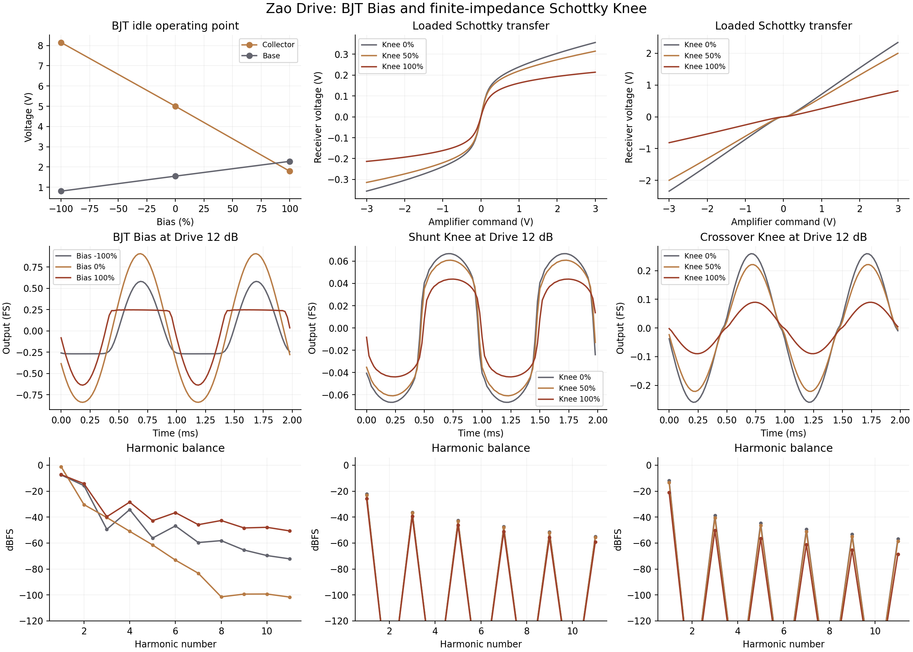
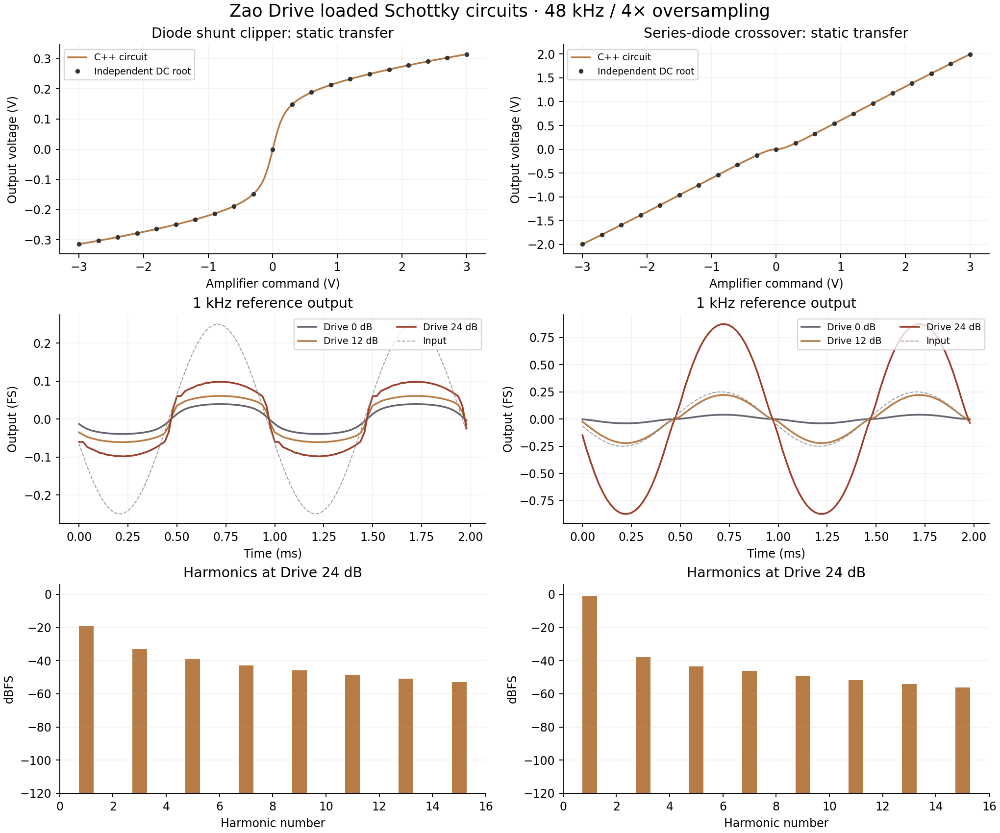
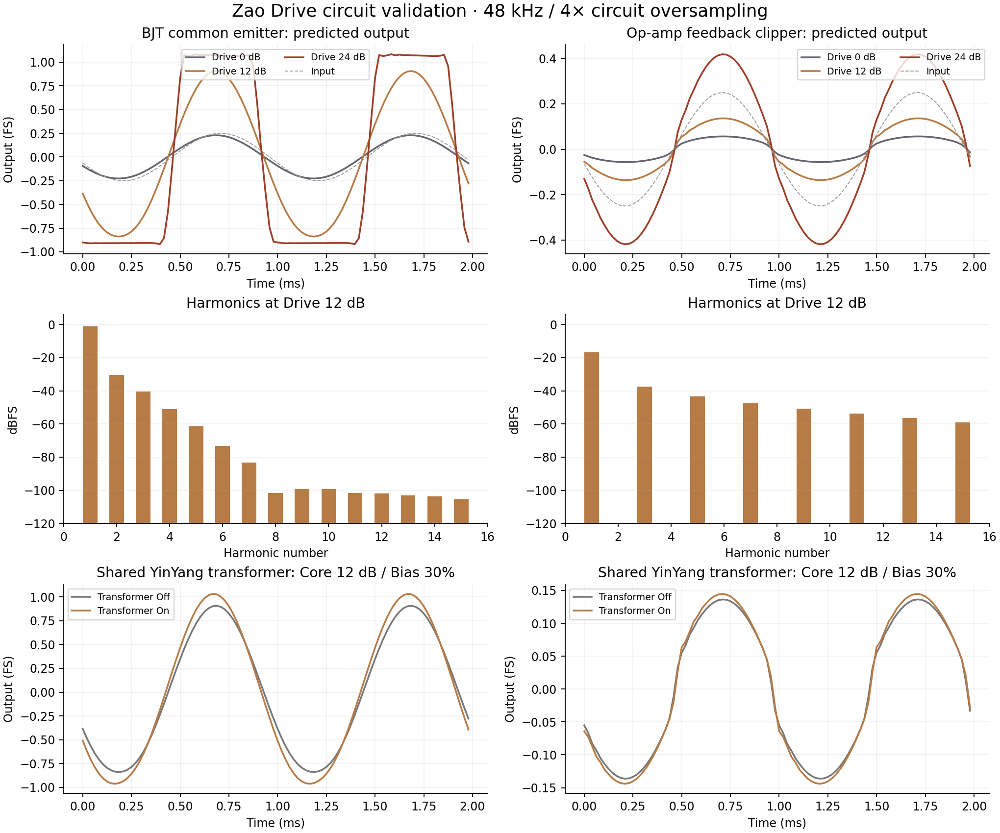

# Zao Drive circuit test report

## Schottky diodes and amplifier impedance

All three diode circuits use nominal Schottky junctions (Is 200 nA, nVt
31.02 mV) and a 220 Ω series ballast. A lower forward voltage alone does not
ensure softness: the ballast gives the conducting pair a finite incremental
resistance. The two external diode networks are driven by a loaded amplifier
whose output impedance, current delivery and bandwidth depend on Knee:

| Knee | Driver resistance | Current limit | Bandwidth |
| --- | --- | --- | --- |
| 0% | 220 Ω | 10 mA | 45 kHz |
| 50% | 2.2 kΩ | 3.162 mA | 15 kHz |
| 100% | 22 kΩ | 1 mA | 5 kHz |

These resistances add to the circuit's own source resistor. The amplifier's
smooth ±9 V swing and smooth current limit enter the receiving circuit's KCL;
the driver is not an ideal gain feeding a square voltage clamp. Knee controls
impedance and headroom, so it also changes level. The feedback mode additionally
models 100 Ω op-amp output resistance supplying the feedback network and a
100 kΩ receiver, while retaining its ±4 V internal rail and 1 V/µs slew limits.

For a 4 V, 1 kHz shunt command at 192 kHz internal rate, the fraction of samples
above 95% of each waveform's own peak falls from
**59.4%** in an independent static
solve of the former ideal-source silicon network to
**33.3%** in the new loaded
Schottky circuit. This is a specified flat-top benchmark, not a listening test.

## BJT nonideal bias

Bias shifts the base divider's Thevenin voltage by −0.8 to +0.8 V while retaining
its source impedance. It changes the transistor's actual DC operating point and
asymmetric headroom; it is not a digital offset added after clipping. The input
and emitter coupling states are initialized at that operating point. During
automation, Bias and the diode driver parameters are smoothed over 20 ms.

| Bias | Base | Collector |
| --- | --- | --- |
| -100% | 0.807839 V | 8.149576 V |
| 0% | 1.549235 V | 4.999450 V |
| 100% | 2.279659 V | 1.790037 V |

Independent SciPy DC solves agree within **2.256e-10 V** across these bias
settings; nominal-bias node error is **7.239e-13 V**. Maximum BJT KCL residual
under ±12 V noise and overload, across Bias −100/0/+100% and internal rates
128/192/384 kHz, is **9.999e-11 A**.

## Numerical validation

Independent bracketing solves include the Schottky ballast, amplifier current
limit, amplifier resistance and receiving load. The settled C++ transfer curves
agree within **2.788e-09 V** (shunt) and **1.485e-09 V** (crossover)
at Knee 50%; maximum error at the Knee endpoints is **9.159e-09 V**.
The largest shunt/crossover KCL residuals at all three Knee positions under
noise and abrupt overload at 128/192/384 kHz are
**6.593e-10 A** and
**9.985e-13 A**. The scalar solves are bounded to
40 iterations; very stiff capacitor transitions can stop above the 1e-12 A
convergence target while remaining within the tested 1e-9 A bound.
The feedback circuit's largest equation residual in the level sweep is
**9.997e-11 V**. Its rails, slew rate and diode
symmetry are tested independently of these DC checks.

## Audio, transformer and host behavior

The plots use a −12 dBFS 1 kHz input, Output 0 dB, Mix 100%, Tone 18 kHz and
transformer Off unless labeled. The shape plots sweep BJT Bias and diode Knee
at Drive 12 dB. A 9 kHz op-amp input at Drive 24 dB has **25.4 dB**
less folded third harmonic with 4× circuit oversampling than at the host rate.
YinYang's directly included transformer still matches the original class within
1e-6 FS when isolated with Mix 0%. Dry mix and bypass preserve reported latency.
Mono/stereo, oversized blocks, parameter recall, and maximum-drive stability
while Bias/Knee automation changes are also exercised.

The first knob binds to BJT Bias, Op-Amp Input, or the shared diode Knee according
to mode. Bias and Knee use new independent host parameters, preserving the
existing parameter IDs, normalized circuit mapping and input-gain automation.
Old presets default to Bias 0% and Knee 50% even after another preset has used
different values. The expected-output display uses the same engine and includes
the new controls. Native editor checks cover all four contextual bindings,
parameter changes, one-sentence hints, and 50–120% scaling.

The models specify nominal components; they are not a calibrated particular
pedal or Schottky part. Full equations and limits are in
[CIRCUITS.md](../../CIRCUITS.md). Raw data includes
[shape-waveforms.csv](shape-waveforms.csv), [bias-operating-points.csv](bias-operating-points.csv),
[knee-transfer.csv](knee-transfer.csv), [shape-residuals.csv](shape-residuals.csv),
[waveforms.csv](waveforms.csv) and [diode-transfer.csv](diode-transfer.csv).
The shape, circuit and diode figures have matching PDF versions.

## Validation — 2026-10-22

Linux Release VST3 and Standalone builds passed without compiler warnings.
All 137 circuit/processor checks passed. Native editor validation passed 182
checks with the tooltip visible, including mode-specific control rebinding,
independent host automation and recall, waveform updates and both resize limits.
The per-mode preview runs each passed 181 checks. Windows workflows were not
changed or run.
