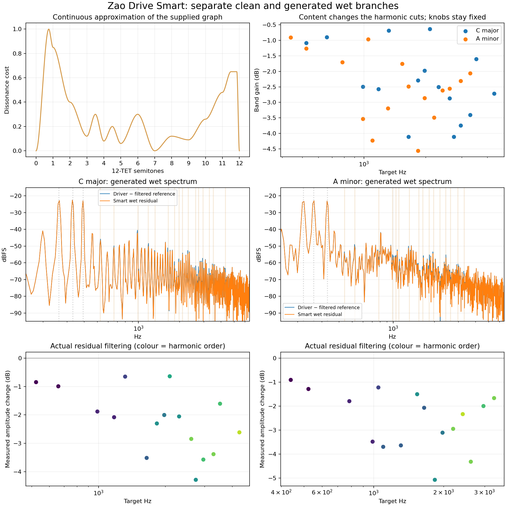

# Zao Drive Smart harmonic report

The driver and clean input run in parallel. A linear-phase grey-noise-style
FIR shapes the driver feed. The circuit output minus its aligned filtered
reference forms the wet residual; Tone and Smart process this residual, then Mix
adds it to the clean branch. Circuit gain/phase changes can remain in that
residual, so subtraction alone does not mathematically isolate only higher orders.
Smart protects existing input peaks and targets measured added harmonic orders
2–12 using a continuous approximation of the supplied 12-TET dissonance graph.
Drive, Bias, Knee, and the circuit equations stay unchanged.

## Measured audio

All four real circuit engines render C major (C4/E4/G4) and A minor (A3/C4/E4)
at 48 kHz, 0.1 FS peak per sine, Drive 24 dB, Tone 18 kHz, Mix 100%, Output
0 dB, transformer Off, with grey shaping enabled. A Hann-windowed 4096-sample frame determines the targets.
The actual causal filter bank then processes the recorded residual with that
steady-state analysis snapshot. The final 8192 samples are measured by Hann-windowed
Fourier projection at each selected harmonic frequency; these are measured
results, rather than the optimizer's predicted attenuation. Polyphonic leakage
and nearby harmonics can affect the measurements.

| Circuit | Chord | Target bands | Weighted harmonic energy reduction | Target harmonic energy retained |
| --- | --- | ---: | ---: | ---: |
| BJT CE | C major | 12 | 28.5% | 75.0% |
| BJT CE | A minor | 14 | 26.7% | 79.5% |
| Op-Amp feedback | C major | 16 | 31.9% | 73.3% |
| Op-Amp feedback | A minor | 16 | 36.3% | 70.0% |
| Diode shunt | C major | 16 | 31.7% | 73.4% |
| Diode shunt | A minor | 16 | 35.9% | 70.4% |
| Series crossover | C major | 1 | 13.3% | 86.7% |
| Series crossover | A minor | 4 | 21.9% | 79.1% |

The cost is the sum of target harmonic power times its interval dissonance;
retention is the power remaining at those targets, not total output loudness.
Consonant or input-overlapping frequencies are protected; there is no overall
drive reduction or normalization trick. Band cuts are bounded at 6 dB each.
The sampled graph is a musical heuristic, not a universal perceptual clarity metric.

The independent clean-branch reconstruction error is below 2e-5 FS in the CSV
round trip. The synthetic known-harmonic test additionally keeps the three
original chord tones within 0.15 dB, checks actual attenuation of added energy,
and confirms different targets for major and minor content.

## Real-time and host checks

The processor test feeds live circuit audio to the worker, exercises publication
and stale-result rejection, checks that Smart Off submits no FFT jobs, verifies
unchanged reported latency and unchanged manual controls, and saves/restores
Smart including legacy presets. Silence, noise, anti-phase stereo, consonance
anchors and bounded harmonic cuts are covered. New filter banks crossfade over
50 ms; analysis refreshes at most four times per second after the first full
frame. No FFT or circuit search runs in the audio callback.

Source data: [audio](smart-audio.csv), [target bands](smart-bands.csv),
[predicted scores](smart-scores.csv), [dissonance curve](smart-dissonance.csv).
The matching [PDF](smart-report.pdf) can be exported. See [SMART.md](../../SMART.md)
for the signal path, formulas and separation limits.
